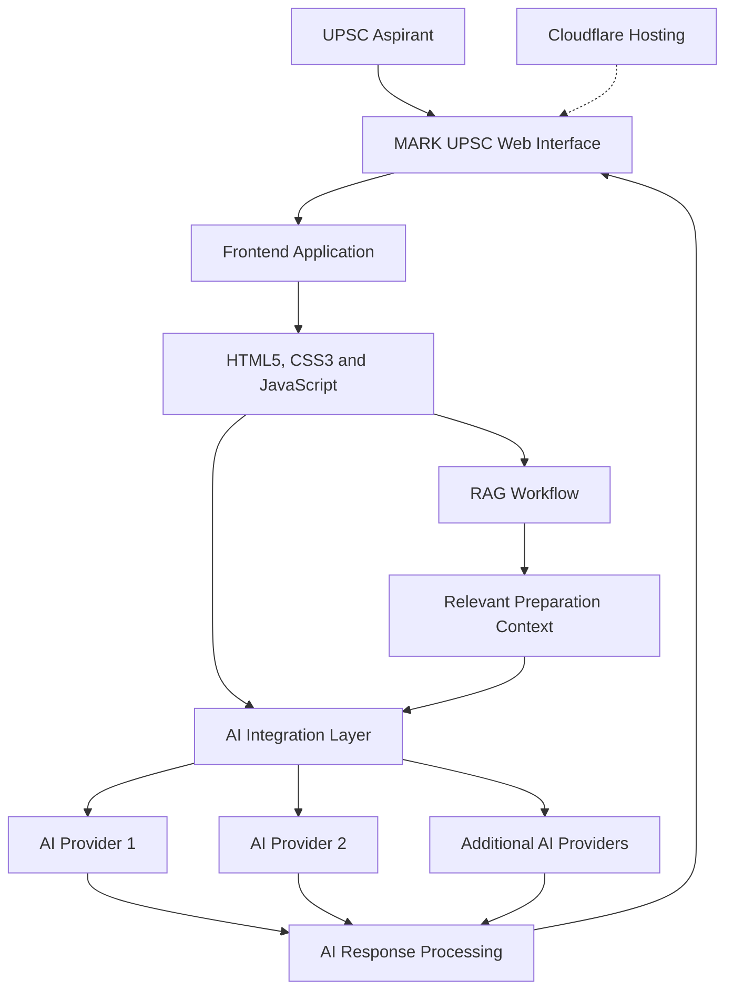

MARK UPSC 🚀

AI-Powered UPSC Civil Services Examination Preparation Platform

Prepare smarter. Evaluate better. Move closer to your civil services dream.

MARK UPSC is an AI-powered comprehensive preparation platform designed to support UPSC Civil Services Examination aspirants throughout their preparation journey.

🌐 Live Website: https://markupsc.in

---

🎯 Project Overview

MARK UPSC aims to bring structured preparation resources, AI-powered answer evaluation, examination support, and interview preparation into one accessible digital learning platform.

The project combines modern web technologies with Artificial Intelligence and Large Language Models (LLMs) to support a more effective and interactive preparation experience.

---

✨ Key Features

📚 Comprehensive Study Resources

- Structured UPSC preparation materials.
- Exam-oriented learning resources.
- Support for different stages of UPSC CSE preparation.

🤖 AI-Powered Answer Evaluation

- Intelligent answer assessment using AI.
- LLM-powered evaluation capabilities.
- Technology-driven feedback to support answer improvement.

🎯 Examination Preparation

- Resources and tools for UPSC examination preparation.
- Support for Prelims and Mains preparation.

🎤 Interview Preparation

- Dedicated resources for UPSC Personality Test preparation.
- Support for interview readiness.

🌐 Accessible Learning Platform

- Web-based learning experience.
- Centralized access to preparation resources.
- Designed to support UPSC aspirants throughout their preparation journey.

---

🛠️ Technology Stack

MARK UPSC combines modern web technologies with AI-powered capabilities.

Technology| Purpose
HTML5| Web page structure
CSS3| Styling and responsive UI
JavaScript| Frontend functionality
Large Language Models (LLMs)| AI-powered capabilities
Retrieval-Augmented Generation (RAG)| Context-aware information retrieval
Cloudflare| Website hosting and deployment

💡 Technical Highlights

- AI and LLM-based capabilities for intelligent learning support.
- Web-based application architecture.
- RAG technology for retrieval-based AI workflows.
- Cloudflare-based hosting and deployment.

---
---

 🏗️ System Architecture

MARK UPSC follows a web-based architecture integrating frontend technologies, multiple AI services, and retrieval-based workflows.

 ⚙️ Architecture Highlights

- **Multi-Provider AI Integration:** Integration with multiple AI APIs for intelligent platform capabilities.
- **LLM-Based Processing:** AI-powered workflows for learning and answer evaluation.
- **Retrieval-Augmented Generation:** Context-aware information retrieval for supported workflows.
- **Web Technologies:** HTML5, CSS3 and JavaScript-based application.
- **Cloud Deployment:** Website hosting and deployment through Cloudflare.