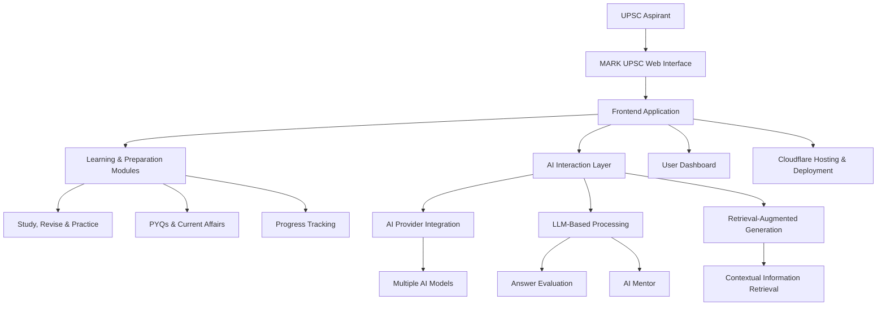

MARK UPSC 🚀

AI-Powered UPSC Civil Services Examination Preparation Platform

Prepare smarter. Evaluate better. Move closer to your civil services dream.

MARK UPSC is an AI-powered comprehensive preparation platform designed to support UPSC Civil Services Examination aspirants throughout their preparation journey.

🌐 Live Website: https://markupsc.in

---

🎯 Project Overview

MARK UPSC aims to bring structured preparation resources, AI-powered answer evaluation, examination support, and interview preparation into one accessible digital learning platform.

The project combines modern web technologies with Artificial Intelligence and Large Language Models (LLMs) to support a more effective and interactive preparation experience.

---

✨ Key Features

📚 Comprehensive Study Resources

- Structured UPSC preparation materials.
- Exam-oriented learning resources.
- Support for different stages of UPSC CSE preparation.

🤖 AI-Powered Answer Evaluation

- Intelligent answer assessment using AI.
- LLM-powered evaluation capabilities.
- Technology-driven feedback to support answer improvement.

🎯 Examination Preparation

- Resources and tools for UPSC examination preparation.
- Support for Prelims and Mains preparation.

🎤 Interview Preparation

- Dedicated resources for UPSC Personality Test preparation.
- Support for interview readiness.

🌐 Accessible Learning Platform

- Web-based learning experience.
- Centralized access to preparation resources.
- Designed to support UPSC aspirants throughout their preparation journey.

---

🛠️ Technology Stack

MARK UPSC combines modern web technologies with AI-powered capabilities.

Technology| Purpose
HTML5| Web page structure
CSS3| Styling and responsive UI
JavaScript| Frontend functionality
Large Language Models (LLMs)| AI-powered capabilities
Retrieval-Augmented Generation (RAG)| Context-aware information retrieval
Cloudflare| Website hosting and deployment

💡 Technical Highlights

- AI and LLM-based capabilities for intelligent learning support.
- Web-based application architecture.
- RAG technology for retrieval-based AI workflows.
- Cloudflare-based hosting and deployment.

---
---

 # 🏗️ System Architecture & Technical Design

MARK UPSC follows a modular, web-based architecture designed to integrate multiple AI providers, intelligent learning workflows, and UPSC preparation resources into a unified platform.

The architecture combines frontend technologies, AI-powered processing, context-aware retrieval, and cloud-based deployment to deliver an accessible and scalable learning experience.

# 🔄 High-Level Architecture

# ⚙️ Core Architectural Components

- **Frontend Application:** Web-based interface built using HTML5, CSS3 and JavaScript.
- **Modular Learning System:** Integrates study materials, revision, practice, quizzes and progress tracking.
- **Multi-Provider AI Integration:** Connects multiple AI services through an intelligent integration layer.
- **LLM-Based Processing:** Supports AI-powered answer evaluation, learning assistance and interview preparation.
- **Retrieval-Augmented Generation (RAG):** Enables context-aware information retrieval for supported AI workflows.
- **Cloud Deployment:** Website hosting and deployment through Cloudflare.

# 🧠 AI Integration Architecture

MARK UPSC incorporates multiple AI providers to support intelligent educational workflows.

Key capabilities include:

- Multi-provider AI integration.
- LLM-powered answer evaluation.
- Context-aware AI assistance.
- AI mentor functionality.
- Retrieval-based information processing.
- AI-assisted UPSC preparation workflows.

# 📚 Application Workflow

1. Aspirants access the MARK UPSC web platform.
2. Users interact with the preparation dashboard.
3. Learning modules provide study, revision and practice resources.
4. AI services support answer evaluation and learning assistance.
5. Progress tracking helps monitor preparation activities.

# 🚀 Architecture Highlights

- Modular and extensible design.
- Multiple AI provider integration.
- AI-assisted educational workflows.
- Context-aware information retrieval.
- Unified UPSC preparation experience.
- Cloud-based deployment.
- Foundation for future scalability and enhancements.
---

 🖥️ Platform Preview

 # 🏠 Homepage

# 📊 Aspirant Dashboard

Explore the platform: https://markupsc.in