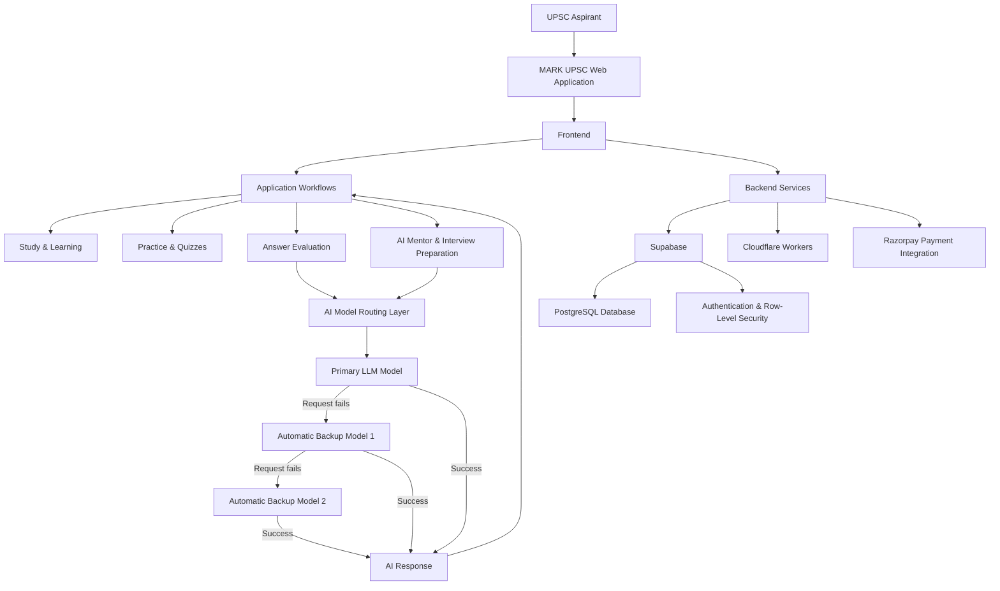
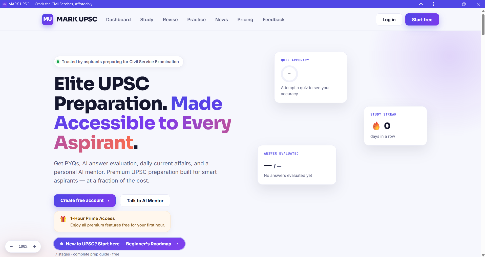
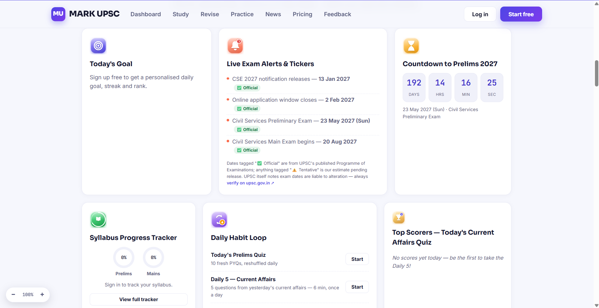
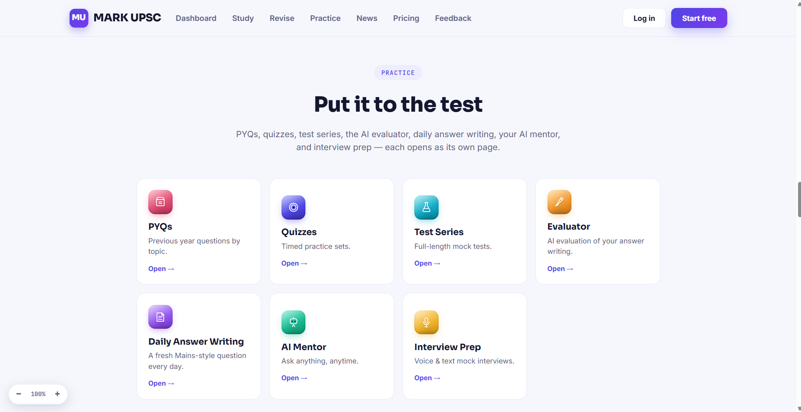
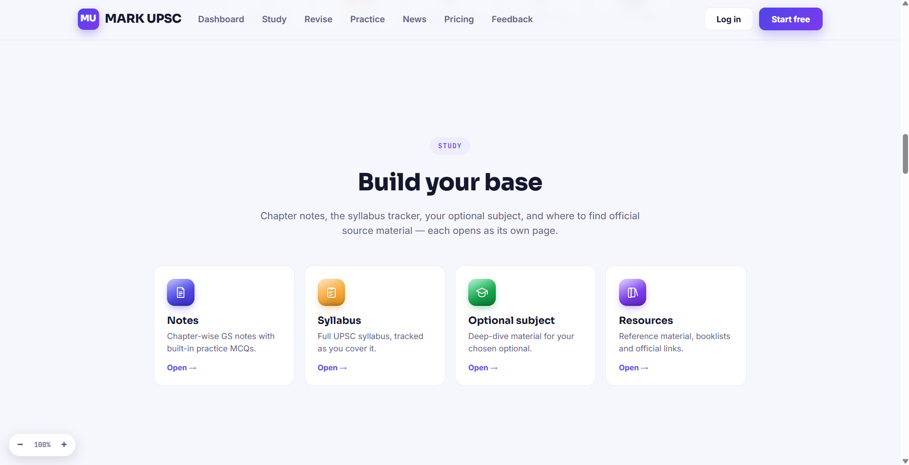
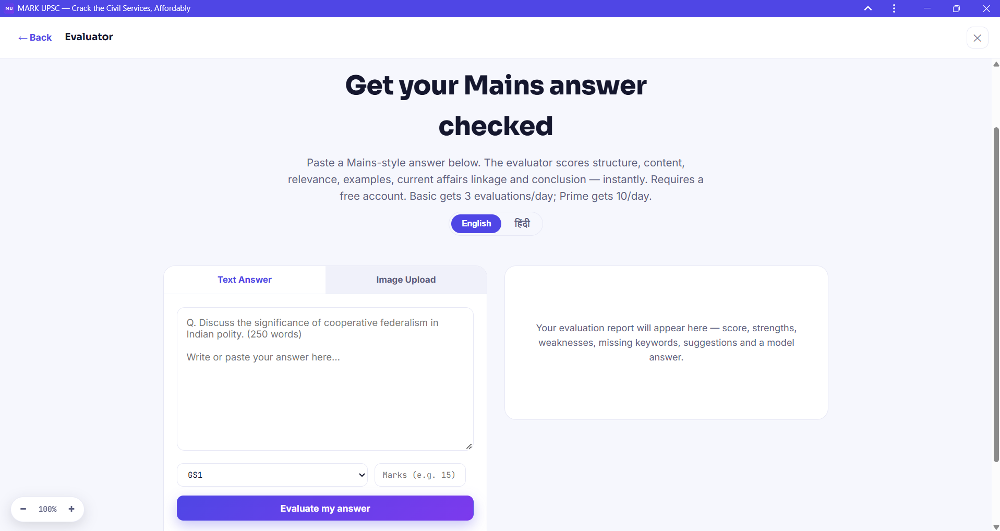

# MARK UPSC

### Elite UPSC Preparation. Made Accessible to Every Aspirant.

MARK UPSC is an AI-assisted UPSC Civil Services preparation platform
that brings learning resources, practice tools, answer evaluation and AI
mentorship into one web application.

**Website:** https://markupsc.in\
**Repository:** https://github.com/markupsc-in/markupsc-platform

------------------------------------------------------------------------

## ✨ Key Features

### 🏠 Aspirant Dashboard

-   Daily study goals, habit tracking and study streaks.
-   Learning progress indicators.
-   UPSC examination alerts and important-date information.
-   Prelims countdown and preparation overview.
-   Daily quizzes and current-affairs practice.

### 📚 Study

-   Chapter-wise General Studies notes.
-   UPSC syllabus tracker.
-   Optional-subject learning resources.
-   Reference materials, booklists and official links.

### 📝 Practice

-   Previous Year Questions (PYQs), organized by topic.
-   Practice quizzes and test series.
-   Daily answer-writing practice.
-   AI-powered Mains answer evaluation.
-   AI Mentor for preparation-related assistance.
-   Interview preparation support.

### 🤖 AI-Powered Answer Evaluation

-   Submit a Mains-style answer as text or an uploaded image.
-   Select the relevant General Studies paper and marks.
-   Receive an evaluation report with feedback.
-   Evaluation can cover structure, content, relevance, examples,
    current-affairs linkage and conclusion.

### 🧭 Beginner's Roadmap

A guided starting point for aspirants beginning their UPSC preparation.

------------------------------------------------------------------------

## 🏗️ System Architecture

MARK UPSC uses a modular web application architecture. The frontend
communicates with backend services for application data, authentication
and feature workflows. AI-powered features connect to external LLM
providers through a configured model-integration layer.



### 🤖 AI Integration & Automatic Failover

MARK UPSC integrates multiple LLM providers:

-   **Groq**
-   **Google Gemini**
-   **OpenRouter**

The AI integration uses a configured primary model with two connected
backup models.

**Automatic failover workflow:**

1.  An AI request is sent to the configured primary model.
2.  If the primary model request fails, the system automatically tries
    Backup Model 1.
3.  If Backup Model 1 also fails, the system automatically tries Backup
    Model 2.
4.  When a model responds successfully, its response is returned to the
    application.
5.  If all configured models fail, the application handles the
    unsuccessful request.

This design improves AI feature availability by providing alternative
models when a request fails.

> The providers listed above are integrated options. Exact
> provider-to-model assignments and failure-handling conditions depend
> on the application's implementation.

------------------------------------------------------------------------

## 💻 Technology Stack

  Area                                 Technology
  ------------------------------------ -----------------------------------
  Database                             Supabase PostgreSQL
  Authentication                       Supabase Auth
  Database security                    Supabase Row-Level Security (RLS)
  Backend / serverless API workflows   Cloudflare Workers
  AI integration                       Groq, Google Gemini, OpenRouter
  Payments                             Razorpay
  Version control                      Git
  Source code hosting                  GitHub
  Deployment / edge platform           Cloudflare

------------------------------------------------------------------------

## 🔐 Security & Reliability

-   Supabase authentication for account-related workflows.
-   PostgreSQL with Row-Level Security (RLS) for database access
    control.
-   Serverless API workflows using Cloudflare Workers.
-   Multiple LLM integrations with automatic backup-model failover.
-   Payment processing through Razorpay.

------------------------------------------------------------------------

## 🧩 Design Principles

-   Modular and extensible architecture.
-   Multiple AI provider integration.
-   AI-assisted educational workflows.
-   Context-aware information retrieval.
-   Unified UPSC preparation experience.
-   Cloud-based deployment.
-   Foundation for future scalability and enhancements.

------------------------------------------------------------------------

## 📸 Screenshots

Place the project screenshots in a `screenshots/` folder in this
repository, using the filenames below.

### Homepage



### Aspirant Dashboard



### Study Section



### Practice Section



### AI Answer Evaluator



------------------------------------------------------------------------

## 🚀 Getting Started

Clone the repository:

``` bash
git clone https://github.com/markupsc-in/markupsc-platform.git
cd markupsc-platform
```

Install dependencies using the package manager and instructions defined
by the project:

``` bash
npm install
```

Start the development server using the script configured in
`package.json`:

``` bash
npm run dev
```

> These are common npm-based setup commands. Confirm the package
> manager, scripts and required environment variables against the
> current project configuration before running locally.

------------------------------------------------------------------------

## 👨‍💻 Project

**MARK UPSC** --- AI-assisted UPSC Civil Services preparation platform.

-   Website: https://markupsc.in
-   GitHub: https://github.com/markupsc-in/markupsc-platform

------------------------------------------------------------------------

*Built to make structured, technology-enabled UPSC preparation more
accessible.*
